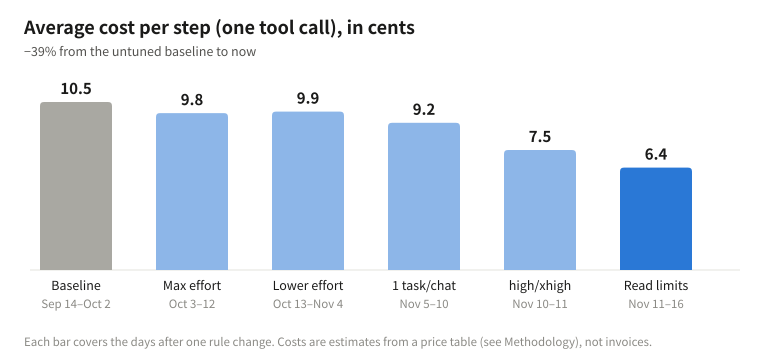
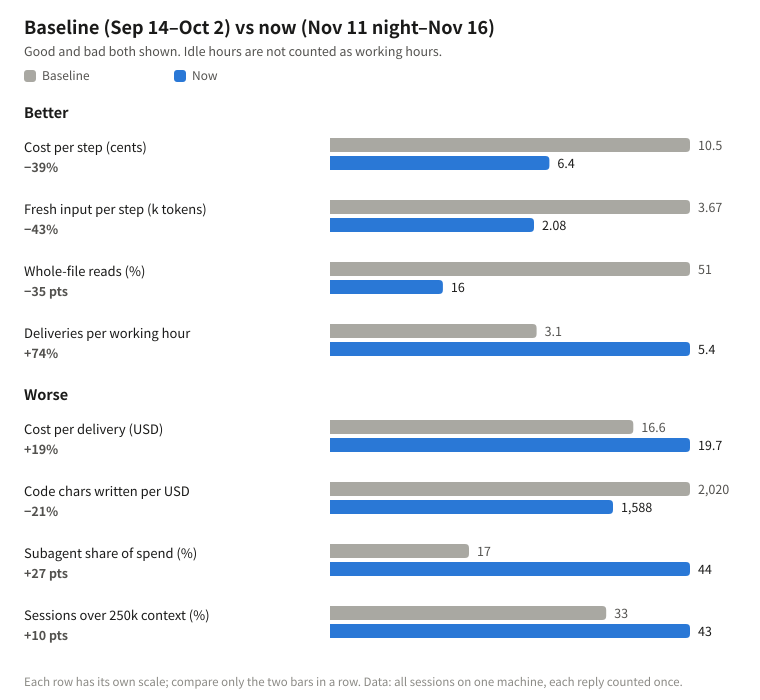

# cheap-vibecoding

[简体中文](README.md) | **English**

A small, dependency-free kit for running many AI coding-agent sessions on one machine without burning money. Four flavours: **Claude Code, OpenAI Codex, Google (Antigravity CLI / Gemini CLI) and DeepSeek** (via Claude Code). It has a hook that stops the agent from dumping whole big files into its context, a shared test queue (one pool for sessions + tests, heavy-suite tiering, a 15-minute circuit breaker, a free-memory floor), scripts that measure where your tokens go, and the rules/prompt templates we use. Measured on our own workstation against the untuned baseline: cost per step **−39%** (10.5 → 6.4 cents), whole-file reads 51% → 16%, deliveries per working hour 3.1 → 5.4 — but cost per delivery went **up** 19% and subagent spend share rose 17% → 44%. Both sides are in the [data report](docs/data-report.en.md). The numbers in `config/` are tuned for a 64 GB / 24-thread box; **measure and retune for your own machine** (see "Tune for your machine").

---

A set of practices and small tools for running **many AI coding-agent sessions at once without burning money**: hooks, a test queue, token-usage scripts, rules and prompt templates. Everything is a single-file Node.js script with no dependencies.

**Four versions**: Claude Code, OpenAI Codex, Google (Antigravity CLI; the older Gemini CLI can also be configured), and DeepSeek (through Claude Code pointed at its API). The hooks and tools are shared; each of the four has its own rules template and config examples. See "Four versions" below.

All of this was built by a small team over two months while using AI to write a business system with about twenty sessions running at once, adjusting as the bills came in. We measured the good and the bad honestly; see the [data report](docs/data-report.en.md).

## Where it saves, and where it doesn't



**What got cheaper** (from the untuned baseline, Sep 14 – Oct 2, to now, Nov 11 (night) – Nov 16):

| Metric | Untuned baseline | Now | Change |
|---|---|---|---|
| Cost per step (one tool call) | 10.5 cents | 6.4 cents | −39% |
| Fresh input per step (tokens newly entering context) | 3.67k tokens | 2.08k tokens | −43% |
| Share of whole-file reads | 51% | 16% | −35 pts |
| Deliveries per working hour (idle hours excluded) | 3.1 | 5.4 | +74% |

**What didn't get cheaper, or got worse**:

| Metric | Untuned baseline | Now | Change |
|---|---|---|---|
| Cost per delivery | $16.6 | $19.7 | +19% |
| Characters written into code per dollar | 2,020 | 1,588 | −21% |
| Subagent share of spend | 17% | 44% | +27 pts |
| Share of sessions with context over 250k | 33% | 43% | +10 pts |

In plain terms:

- **The unit price can be pushed down**: read less, read only the lines you need, write command output to disk, and don't run at the top effort level. Each step really did get about 40% cheaper.
- **The total bill can't**: as the number of parallel sessions grows, daily spend still rises (ours went from about $390/day to about $2,230/day). Saving per step is not saving overall; **the number of parallel sessions is the master switch**.
- **Don't hand out subagents freely**: one subagent ($5.2) is cheaper than one fresh session ($9.1), but we launched 916 of them in 4 days, and that is where the money went.
- **A stuck test is usually a queued test**: of tests that took over 10 minutes, 67% were waiting for a slot, not running slowly. That is why we put sessions and tests into one shared pool and schedule them together.
- **Hooks beat words in the rules**: reminders in the rules alone never brought the whole-file-read share down; after we added a hook, the next period dropped from over 50% to just over 10%.

## Four versions: how far each one goes

In November 2026 we checked each item against each vendor's current official docs (links below the table). "Tested" = installed on our own machine and seen actually blocking; "per docs" = not installed or no account, written from the official docs, may be off. Issues with corrections are welcome.

| | Claude Code | OpenAI Codex | Google Antigravity CLI (agy) | DeepSeek |
|---|---|---|---|---|
| What it is | Anthropic's coding agent | OpenAI's coding agent (CLI and desktop app share the same setup) | Google's current coding agent; since 2026-06-18 Gemini CLI is no longer available to personal accounts (enterprise and paid API keys still work) | **No coding agent of its own**. One of its officially recommended setups: Claude Code pointed at `api.deepseek.com/anthropic` (Codex, OpenCode and others are also listed) |
| Rules file | `CLAUDE.md` (project root, `~/.claude/`) | `AGENTS.md` (every project level, `~/.codex/`; 32 KiB combined by default) | `AGENTS.md` or `GEMINI.md`, `.agents/rules/*.md`, `~/.gemini/GEMINI.md` (global and always-on rules share about 20k tokens) | Same as Claude Code: `CLAUDE.md` |
| Our template | [rules/claude/CLAUDE.en.md](rules/claude/CLAUDE.en.md) | [rules/codex/AGENTS.en.md](rules/codex/AGENTS.en.md) | [rules/google/GEMINI.en.md](rules/google/GEMINI.en.md) | [rules/deepseek/CLAUDE.en.md](rules/deepseek/CLAUDE.en.md) |
| Blocking hook available? | Yes: PreToolUse (`settings.json`) | Yes: PreToolUse (`~/.codex/hooks.json`), format almost identical to Claude's; the first time you must **trust** it in `/hooks` or settings, otherwise it is silently skipped | Yes: PreToolUse (`.agents/hooks.json`), returns `{"decision":"deny"}`; the old Gemini CLI uses BeforeTool | Same as Claude Code |
| Read line limit | Blocks Read and cat / Get-Content in the shell | Blocks the shell (Codex reads all files through the shell) | Blocks view_file and run_command | Same as Claude Code |
| Test queue | Hook blocks unqueued tests | Hook blocks | Hook blocks | Same as Claude Code |
| Effort level | `effortLevel` + per-model `modelSettings`; `/effort` | `model_reasoning_effort` (low…xhigh, max, ultra, depending on model) | `/effort` (low…max, depending on model) | Claude Code's `/effort`; the official example sets `CLAUDE_CODE_EFFORT_LEVEL=max`, which we don't recommend (see below) |
| Session logs and per-step usage | `~/.claude/projects/**/*.jsonl`, every reply carries usage | `~/.codex/sessions/<year>/<month>/<day>/rollout-*.jsonl`, each step has `token_count` / `token_usage_record` (this format isn't in the official docs; we read it from our local logs) | Has session logs (`brain/<session>/…/transcript.jsonl`), but the docs don't say they contain usage; **the usage scripts can't read them**. The old Gemini CLI's `~/.gemini/tmp/*/chats/*.json` carries tokens and the scripts can read it (per docs) | Same logs as Claude; the scripts split it out by "deepseek" in the model name |
| Config examples | [examples/claude/](examples/claude/) | [examples/codex/](examples/codex/) | [examples/google/](examples/google/) | [examples/deepseek/](examples/deepseek/) |
| How far we tested | Tested (two months) | Tested: both hooks actually blocked in our local Codex 0.169; the usage scripts have read 877 local logs | **Per docs**, not installed locally | Hooks and tools same as Claude, tested; **DeepSeek API per docs**, no account, never run |

The `.en.md` rules files are English translations. Copy the one for your agent into the file name it actually reads (`CLAUDE.md`, `AGENTS.md` or `GEMINI.md`).

Without hooks, or when the hooks aren't wired up, you only have the words in the rules file, and **they don't stop anything** (we measured: with rules alone, whole-file reads never came down). Alternatives:

- The test queue works for anyone, no hook needed: `node tools/test-queue.cjs run --label <name> -- <command>`, and state in the rules that "all tests run this way".
- The usage scripts need no hook: run `node tools/token-usage.cjs --agent <agent>` regularly and check whether the whole-file-read and re-read shares are coming down.

Official docs (checked 2026-11): [Claude Code hooks](https://docs.claude.com/en/docs/claude-code/hooks) · [Codex AGENTS.md](https://learn.chatgpt.com/docs/agent-configuration/agents-md) · [Codex hooks](https://learn.chatgpt.com/docs/hooks) · [Codex config](https://learn.chatgpt.com/docs/config-file/config-reference) · [Antigravity rules](https://antigravity.google/docs/rules) · [Antigravity hooks](https://antigravity.google/docs/hooks) · [Gemini CLI to Antigravity CLI](https://developers.googleblog.com/an-important-update-transitioning-gemini-cli-to-antigravity-cli/) · [Gemini CLI hooks](https://geminicli.com/docs/hooks/) · [DeepSeek coding agent setup](https://api-docs.deepseek.com/guides/coding_agents) · [DeepSeek with Claude Code](https://api-docs.deepseek.com/quick_start/agent_integrations/claude_code)

## What's inside

```
hooks/
  read-limit-hook.cjs     Read line-limit hook: no whole-file reads of big files, at most 60 lines per read
  test-queue-hook.cjs     Test queue hook: blocks tests not run through the queue and returns the rewritten command
  lib/agent-io.cjs        Translation layer for the four agents' hook input/output formats (pass --agent codex / antigravity / gemini, or omit to auto-detect)
tools/
  test-queue.cjs          Test queue: shared pool, full-suite / small-test tiers, 15-minute circuit breaker, memory guard
  token-usage.cjs         Usage stats: tokens spent over recent days, approximate dollars, how much was re-reading prior context
  stages.cjs              Stage comparison: splits by the dates you changed your rules; per-stage cost, input and output per step
  lib/sessions.cjs        Reads Claude / Codex / Gemini CLI session logs (--agent picks which)
config/                   Parameters for the above (tune for your machine)
rules/
  claude/CLAUDE.en.md     Token-saving rules template (all four have the same content; they differ only in how each agent reads files and sets effort)
  codex/AGENTS.en.md
  google/GEMINI.en.md
  deepseek/CLAUDE.en.md
  prompt-templates.en.md  Kickoff card, handoff note, daily progress templates
examples/<agent>/         How to register hooks and set effort per agent (DeepSeek includes a launch script)
docs/data-report.en.md    Data report
tests/                    Self-tests (node --test)
```

## Install

Requirements: Node.js 18+; on Windows, shell scripts run in Git Bash (the queue looks for `C:/Program Files/Git/bin/bash.exe` automatically, falls back to the system shell if not found, or set the environment variable `TEST_QUEUE_BASH`).

1. Clone anywhere on your machine:

   ```bash
   git clone https://github.com/<you>/cheap-vibecoding.git
   ```

2. Run the self-tests to confirm it works on this machine:

   ```bash
   cd cheap-vibecoding && npm test
   ```

3. Register the hooks (replace `/path/to/cheap-vibecoding` with where you cloned it):
   - **Claude Code**: merge the `hooks` from [`examples/claude/settings.json`](examples/claude/settings.json) into `~/.claude/settings.json` (global) or the project's `.claude/settings.json`.
   - **Codex**: put [`examples/codex/hooks.json`](examples/codex/hooks.json) at `~/.codex/hooks.json`, and set effort as in [`examples/codex/config.toml`](examples/codex/config.toml); then type `/hooks` in Codex (in the desktop app, the hooks page in settings) and mark both hooks as trusted. **Untrusted hooks are silently skipped**: they look installed but block nothing.
   - **Google Antigravity CLI**: put [`examples/google/hooks.json`](examples/google/hooks.json) at the project's `.agents/hooks.json` or `~/.gemini/config/hooks.json`; for the old Gemini CLI use [`examples/google/gemini-cli-settings.json`](examples/google/gemini-cli-settings.json).
   - **DeepSeek**: hooks same as Claude Code; launch with [`examples/deepseek/start-deepseek.sh`](examples/deepseek/start-deepseek.sh) (`.ps1` on Windows). It points Claude Code at DeepSeek only in that window and doesn't affect your normal Claude Code.
4. Paste your agent's rules template (`rules/<agent>/`) at the top of the rules file it reads, and change the numbers in [ ] to fit your project.
   Try it once after installing: ask the agent to read a 300-line file in full, and to run a test directly. Both should be blocked, with a corrected command returned.
5. **Tune `config/test-queue.json` as described in the next section** before you start.

If a hook itself errors, it always lets the call through (no output, exit code 0), so a broken hook never stalls your session. To turn blocking off while you investigate: set `enabled` in `config/read-limit.json` and `hookEnabled` in `config/test-queue.json` to `false`.

## Tune for your machine (read this)

Our machine: **Windows 11, 64 GB RAM, 24 threads**. The numbers in `config/test-queue.json` (shared pool of 20 slots, 8 GB free-memory floor, etc.) **are tuned for this machine; don't copy them as-is**.

What the shared pool `slots` means: **active sessions + slots taken by running tests ≤ slots**. Each session also uses memory and CPU, so sessions count toward the pool; one `pytest -n K` takes K slots.

Suggested starting points:

| Your RAM | Shared pool `slots` | Min test slots `minTestSlots` | Max full suites at once `heavyMax` | Free-memory floor `minFreeGB` | Circuit breaker minutes `timeoutMinutes` |
|---|---|---|---|---|---|
| 16 GB | 6 | 1 | 1 | 3 | 10 |
| 32 GB | 10 | 2 | 1 | 5 | 15 |
| 64 GB | 20 | 2 | 2 | 8 | 15 |

Also:

- **Measure, then tune.** Use the starting values from the table for two or three days, then run `node tools/test-queue.cjs stats --days 3` to see how many runs took over 10 minutes, what share of those were mostly queueing, and how many hit the circuit breaker; run `node tools/test-queue.cjs status` to see free memory. Mostly queueing → if you have memory to spare, raise `slots`. Actually slow → split the full suite and run only the targeted tests during development; don't add slots.
- **Running out of memory stalls the services you're using.** We learned this the hard way: once we let 8 test runs go at the same time, and a service on the same machine that people were actively using stopped responding. If your dev machine also runs other things (a database, local services, a browser with lots of tabs), set `minFreeGB` on the high side.
- **CPU has a limit too**: the total number of parallel test processes should ideally not exceed the CPU thread count. In the queue, `pytest -n auto` counts as `autoWeight` (default 4 slots); on machines with fewer threads lower it, or just hardcode `-n 2`.
- **Set the circuit breaker by your slowest test that should be run.** Targeted tests during development should finish within 30 seconds; the full test suite belongs in merge and verification review. Anything that can't finish in 15 minutes probably needs splitting.
- **The shared pool must count all your agents**: `sessionDirs` in `config/test-queue.json` lists the session log directories for Claude, Codex and Gemini CLI; an agent you haven't installed counts as 0. If your logs live elsewhere, change `path`. DeepSeek runs on Claude Code, so it counts under the Claude entry.
- **Change paths and shell to your own**: replace the paths in `examples/` with yours; on Windows, run commands in Git Bash. PowerShell works too, but its quoting rules differ.
- **The number of sessions is limited by your plan's quota.** However large the pool, it's no use if the quota can't keep up; the number of parallel sessions is the master switch for spend, see the data report.

## How to set the effort level

The higher each agent's effort level (Claude Code calls it effort, Codex calls it reasoning effort), the more each step thinks and writes, and the more it costs. Our recommendation: **use only high and xhigh; don't use max, and don't use medium.**

| Work | Effort level | Why |
|---|---|---|
| Writing code, fixing bugs, writing docs, read-only checks, querying numbers | **high** | The everyday workhorse; good enough |
| Verification review / re-checks, programs that compute money and accounts, big refactors, subagents doing verification review | **xhigh** | Mistakes here are more expensive to redo, so set effort higher |
| Any work | ~~max~~ off | We measured: in the period with max on everywhere, each step was only 7% cheaper, but daily spend went up 3.2×, cost per delivery went up 40%, and sessions with context over 250k went from 33% to 75% |
| Any work | ~~medium~~ not used | Not measured separately; a trade-off: the savings don't cover the rework caused by not thinking enough |

What we measured (details in the [data report](docs/data-report.en.md)):

| Period | Cost per step | Spend per day | Cost per delivery | Context over 250k |
|---|---|---|---|---|
| Untuned baseline (default effort) | 10.5 cents | about $390 | $16.6 | 33% |
| Max effort everywhere | 9.8 cents | about $1,270 | $23.3 | 75% |
| After switching to high / xhigh only | 7.5 cents | — | $10.1 | 45% |

(The "high / xhigh only" period is just 1 day; the sample is small, so only read the direction.)

**Codex**: in `~/.codex/config.toml` set `model_reasoning_effort = "high"`, and raise verification-review conversations to xhigh when you open them; don't use max or ultra. **Google Antigravity**: `/effort high`. **DeepSeek (via Claude Code)**: set it the same way as Claude Code below; DeepSeek's official example sets `CLAUDE_CODE_EFFORT_LEVEL=max`; see item 5 for why our launch script comments it out.

**Claude Code** (the official docs for your version take precedence):

1. **Global default**: put `"effortLevel": "high"` in `~/.claude/settings.json`.
2. **Set it again per model**: in our version, the top-level `effortLevel` did not apply to newer models. A scheduled task was set to xhigh but actually ran at medium, until we added the per-model setting. So we recommend setting both:

   ```json
   {
     "effortLevel": "high",
     "modelSettings": {
       "<your model ID>": { "effortLevel": "high" }
     }
   }
   ```

   When you switch to a new model, remember to add an entry for it.
3. **Per-session override**: use `/effort xhigh` in the session, or pick it next to the input box in the desktop app. Set verification-review sessions to xhigh as soon as they open.
4. **State the effort level when launching subagents**: xhigh for subagents doing verification review, high for the rest; if you don't set it, it follows the default.
5. **Don't set the environment variable `CLAUDE_CODE_EFFORT_LEVEL`**: it forces every session to the same level, and per-session and per-subagent settings stop working.
6. **Verify after setting it**: check session logs or the usage page to confirm the level actually running matches what you set. That's how we found our scheduled tasks had been running at medium all along.

## How to measure your own

```bash
# Last 7 days: how much was spent, how much was re-reading prior context, subagent share
node tools/token-usage.cjs --days 7

# Another agent: codex / gemini / deepseek; all = one section per agent
node tools/token-usage.cjs --agent codex --days 7

# Compare periods split by the dates you changed your rules (copy config/stages.example.json first and put in your dates)
node tools/stages.cjs --stages config/stages.example.json --out stages-out.json
node tools/stages.cjs --stages config/stages.example.json --agent codex --out stages-codex.json

# Test queue status
node tools/test-queue.cjs status
node tools/test-queue.cjs stats --days 7
```

All of these are read-only. They only read local session logs (Claude, DeepSeek: `~/.claude/projects`; Codex: `~/.codex/sessions`; Gemini CLI: `~/.gemini/tmp`) and make no network calls. For Codex, Gemini and DeepSeek, the dollar figures only mean something after you add that vendor's prices to the price table; token counts are unaffected. Costs are "equivalent dollars" estimated from the price table, not a bill; prices live in `prices` in `config/stages.example.json`, adjust them to your plan. For definitions, see the methodology section of the [data report](docs/data-report.en.md).

## How we got here

We didn't plan this up front; we found it step by step, with some wrong turns. The key steps:

| Date | Problem | What we changed | Result |
|---|---|---|---|
| Sep 14 – Oct 2 | (Baseline) default settings, a few sessions | Nothing tuned | 10.5 cents per step, used as the comparison baseline |
| Oct 3 | Wanted the AI to do better work | Max effort by default for every session | 9.8 cents per step, but daily spend more than tripled, and sessions with context over 250k went from 33% to 75% |
| Oct 13 | Quota ran out fast | Lowered subagents and scheduled checks by one effort level | Per-step cost barely changed (9.9) |
| Oct 15 | Didn't know where the money went | Wrote a read-only usage script (this is `tools/token-usage.cjs`) | Found that over 98% of tokens were re-reading prior context |
| Nov 2 | Scheduled checks called the AI every time | Changed to a program checking first, calling the AI only on new errors | Rounds with no new errors cost no tokens |
| Nov 4 | Lots of spend, few deliveries | One task per fresh conversation, write fresh from the plan, scope fixed when the task is handed out | 9.2 cents per step |
| Nov 5 | Verification review kept failing, leading to full rewrites | Verification review blocks only three kinds of problems (wrong money calculations, messages sent to the wrong place, blocking business in use); the second round only re-checks the first round's items | No more three-to-five-version rewrites |
| Nov 10 | Effort levels used inconsistently | Only high and xhigh, no max | Max usage dropped to zero that day; 7.5 cents per step |
| Nov 10 | Each step re-read 270k tokens on average | Found 57% of fresh input came from command output and 32% from file reads; all command output now goes to disk, only conclusions printed to screen | — |
| Nov 10 | Tried early handoff and auto-compaction at 40% | Replayed at real prices: no savings (−25% to +7%), **reverted** | A wrong turn |
| Nov 11 | About twenty sessions running tests at once froze the machine | At most 8 test runs, all through the queue; each run finishes one closed-loop small feature, and hands off at about 250k context | — |
| Nov 11 (night) | The rules said "read less", the AI still did whole-file reads | Added the read line-limit hook (`hooks/read-limit-hook.cjs`) | Whole-file reads 55% → 16%, per step down to 6.4 cents |
| Nov 12 | Retrospective | Each step was cheaper, but features finished per hour dropped from 10 to 6.2 | Saving money and going faster are not the same thing |
| Nov 13 – Nov 15 | 8 concurrent test runs stalled a service in use | Test slots cut to 4, temporarily to 1 one night | Queues got longer: 67% of tests over 10 minutes were waiting for a slot |
| Nov 16 | Tests stuck in the queue | Sessions and tests share a 20-slot shared pool, full test suite only for merge / verification review, 15-minute circuit breaker, memory guard (`tools/test-queue.cjs`) | To be added to the data report after re-measuring on Nov 19 |
| Nov 16 | Re-did the math | Counted from the untuned baseline and corrected our earlier claim of "59% saved per step" (that one used Nov 10 as the starting point) | Actually −39% |
| Nov 16 | On the same machine, Codex's prior context per step actually rose from 150k to 210k (see section 5 of the data report); the hooks only covered Claude | Confirmed Codex has the same kind of hooks, wired the read line limit and test queue into Codex; the shared pool now also counts Codex sessions; also released Google and DeepSeek versions written per docs | Awaiting re-measurement |

## Data report

The full numbers, charts, definitions and limitations are in [docs/data-report.en.md](docs/data-report.en.md).



## License

[MIT](LICENSE)
