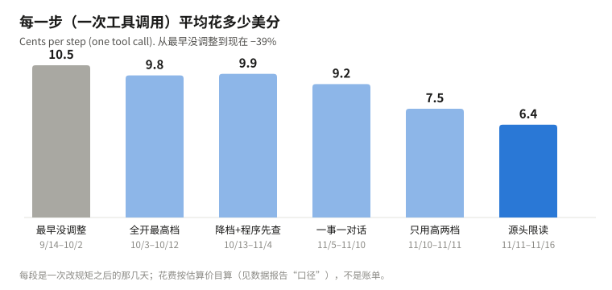
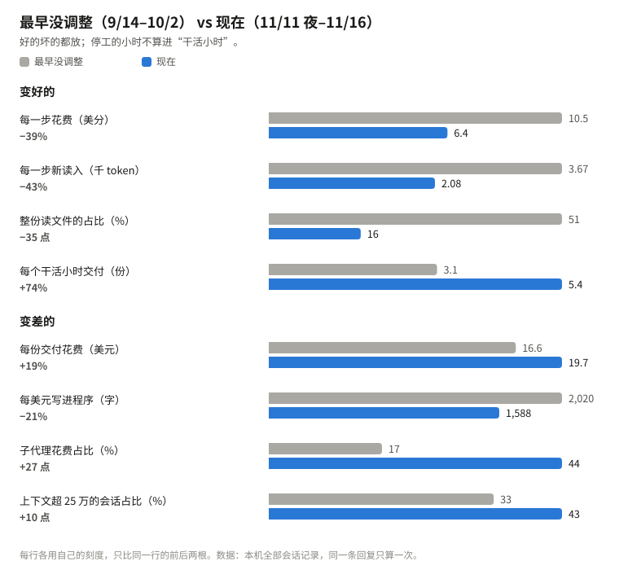

# cheap-vibecoding

**English.** A small, dependency-free kit for running many AI coding-agent sessions on one machine without burning money. Four flavours: **Claude Code, OpenAI Codex, Google (Antigravity CLI / Gemini CLI) and DeepSeek** (via Claude Code). It has a hook that stops the agent from dumping whole big files into its context, a shared test queue (one pool for sessions + tests, heavy-suite tiering, a 15-minute circuit breaker, a free-memory floor), scripts that measure where your tokens go, and the rules/prompt templates we use. Measured on our own workstation from the untuned baseline: cost per step **−39%** (10.5 → 6.4 cents), whole-file reads 51% → 16%, deliveries per working hour 3.1 → 5.4 — but cost per delivery went **up** 19% and subagent spend share rose 17% → 44%. Both sides are in the [data report](docs/data-report.md). The numbers in `config/` are tuned for a 64 GB / 24-thread box; **measure and retune for your own machine** (see “按你的电脑调参”). Docs are in Chinese.

---

一套让 AI 编程助手**同时开很多路也不乱烧钱**的做法和小工具：钩子、测试排队器、用量查数脚本、规矩和提示词模板。全部是 Node.js 单文件，不装任何依赖。

**四个版本**：Claude Code、OpenAI Codex、谷歌（Antigravity CLI，旧版 Gemini CLI 也能配）、DeepSeek（经 Claude Code 接它的接口）。同一套钩子和工具，四家各有一份规矩模板和配置示例，见下面“四个版本”。

这些东西是我们一个小团队在两个月里，用 AI 同时开二十来路会话写一套业务系统时，一边挨账单一边改出来的。好的坏的都照实量了，见 [数据报告](docs/data-report.md)。

## 能省在哪，省不了在哪



**能省的**（从最早没调整 9/14–10/2 到现在 11/11 夜–11/16）：

| 指标 | 最早没调整 | 现在 | 变化 |
|---|---|---|---|
| 每一步（一次工具调用）花费 | 10.5 美分 | 6.4 美分 | −39% |
| 每一步新读进上下文的量 | 3.67 千 token | 2.08 千 token | −43% |
| 整份读文件的占比 | 51% | 16% | −35 点 |
| 每个干活小时交付（停工不算） | 3.1 份 | 5.4 份 | +74% |

**省不了、甚至变差的**：

| 指标 | 最早没调整 | 现在 | 变化 |
|---|---|---|---|
| 每份交付花费 | 16.6 美元 | 19.7 美元 | +19% |
| 每美元写进程序的字数 | 2,020 | 1,588 | −21% |
| 子代理花费占比 | 17% | 44% | +27 点 |
| 上下文超 25 万的会话占比 | 33% | 43% | +10 点 |

说人话：

- **单价能压下来**：少读、只读要的那几行、输出落盘、档位别开最高，每一步确实便宜了四成。
- **总账压不下来**：路数一多，每天总花费照样涨（我们从每天约 390 美元涨到约 2,230 美元）。省单价不等于省总账，**路数是总开关**。
- **子代理别乱派**：一次子代理（5.2 美元）比开一个新会话（9.1 美元）便宜，但我们 4 天派了 916 次，钱就花在这上面。
- **测试卡住多半是在排队**：超过 10 分钟的测试，67% 是在等位子，不是跑得慢。所以我们把会话和测试放进同一个池子统一调度。
- **写在规矩里的话不如钩子**：整份读文件的占比，光在规矩里提醒一直降不下来；加了钩子，下一段就从五成多降到一成多。

## 四个版本：各家能做到哪一步

我们 2026 年 11 月按各家官方现行文档逐项核过（链接在表下）。“已实测”= 在我们自己的机器上装上、真拦下过；“照文档”= 没装或没账号，照官方文档写，可能有出入，欢迎提问题单更正。

| | Claude Code | OpenAI Codex | 谷歌 Antigravity CLI（agy） | DeepSeek |
|---|---|---|---|---|
| 是什么 | Anthropic 的编程助手 | OpenAI 的编程助手（命令行、桌面应用同一套） | 谷歌现在的编程助手；Gemini CLI 2026-06-18 起不再给个人账号用（企业版、付费密钥还能用） | **没有自家编程助手**。官方推荐接法之一：Claude Code 接 `api.deepseek.com/anthropic`（也列了 Codex、OpenCode 等） |
| 规矩文件 | `CLAUDE.md`（项目根、`~/.claude/`） | `AGENTS.md`（项目每层、`~/.codex/`；合计默认 32 KiB） | `AGENTS.md` 或 `GEMINI.md`、`.agents/rules/*.md`、`~/.gemini/GEMINI.md`（全局和常开规则合用约 2 万 token） | 跟 Claude Code：`CLAUDE.md` |
| 我们的模板 | [rules/claude/CLAUDE.md](rules/claude/CLAUDE.md) | [rules/codex/AGENTS.md](rules/codex/AGENTS.md) | [rules/google/GEMINI.md](rules/google/GEMINI.md) | [rules/deepseek/CLAUDE.md](rules/deepseek/CLAUDE.md) |
| 有没有能拦的钩子 | 有：PreToolUse（`settings.json`） | 有：PreToolUse（`~/.codex/hooks.json`），格式和 Claude 几乎一样；第一次要在 `/hooks` 或设置里**信任**，不信任会被静默跳过 | 有：PreToolUse（`.agents/hooks.json`），回 `{"decision":"deny"}`；旧 Gemini CLI 是 BeforeTool | 跟 Claude Code |
| 读文件限行 | 拦 Read 和 shell 里的 cat / Get-Content | 拦 shell（Codex 读文件都走 shell） | 拦 view_file 和 run_command | 跟 Claude Code |
| 测试排队 | 钩子拦没排队的测试 | 钩子拦 | 钩子拦 | 跟 Claude Code |
| 思考档位 | `effortLevel` + 按型号 `modelSettings`；`/effort` | `model_reasoning_effort`（low…xhigh、max、ultra，看型号） | `/effort`（low…max，看型号） | Claude Code 的 `/effort`；官方示例设了 `CLAUDE_CODE_EFFORT_LEVEL=max`，我们不建议（见下文） |
| 会话记录和每步用量 | `~/.claude/projects/**/*.jsonl`，每条回复带 usage | `~/.codex/sessions/年/月/日/rollout-*.jsonl`，每步 `token_count` / `token_usage_record`（官方文档没写这份格式，我们按本机记录读） | 有会话记录（`brain/<会话>/…/transcript.jsonl`），官方没写里面有用量；**查数脚本读不了**。旧 Gemini CLI 的 `~/.gemini/tmp/*/chats/*.json` 带 tokens，脚本能读（照文档） | 同 Claude 记录，脚本按型号名里的 deepseek 分开算 |
| 配置示例 | [examples/claude/](examples/claude/) | [examples/codex/](examples/codex/) | [examples/google/](examples/google/) | [examples/deepseek/](examples/deepseek/) |
| 我们实测到哪 | 已实测（两个月） | 已实测：两个钩子在本机 Codex 0.169 里真拦下过；查数脚本读过本机 877 份记录 | **照文档**，没在本机装 | 钩子、工具同 Claude，已实测；**DeepSeek 接口照文档**，没有账号没跑过 |

没有钩子、或钩子没配上的时候，只能靠规矩文件里的文字，**拦不住**（我们量过：光写在规矩里，整份读文件一直降不下来）。替代办法：

- 测试排队器本身谁都能用，不靠钩子：`node tools/test-queue.cjs run --label <名> -- <命令>`，在规矩里写死“测试一律这样跑”。
- 查数脚本不靠钩子：定期跑 `node tools/token-usage.cjs --agent <家>` 看整份读、重读前文的比例有没有降。

官方文档（2026-11 核）：[Claude Code 钩子](https://docs.claude.com/en/docs/claude-code/hooks) · [Codex AGENTS.md](https://learn.chatgpt.com/docs/agent-configuration/agents-md) · [Codex 钩子](https://learn.chatgpt.com/docs/hooks) · [Codex 配置](https://learn.chatgpt.com/docs/config-file/config-reference) · [Antigravity 规则](https://antigravity.google/docs/rules) · [Antigravity 钩子](https://antigravity.google/docs/hooks) · [Gemini CLI 换 Antigravity CLI](https://developers.googleblog.com/an-important-update-transitioning-gemini-cli-to-antigravity-cli/) · [Gemini CLI 钩子](https://geminicli.com/docs/hooks/) · [DeepSeek 编程助手接法](https://api-docs.deepseek.com/guides/coding_agents) · [DeepSeek 接 Claude Code](https://api-docs.deepseek.com/quick_start/agent_integrations/claude_code)

## 里面有什么

```
hooks/
  read-limit-hook.cjs     读文件限行钩子：大文件不准整份读、一次不超过 60 行
  test-queue-hook.cjs     测试排队钩子：没经排队器跑的测试拦下，并给出改写好的命令
  lib/agent-io.cjs        四家钩子收发格式的翻译层（加 --agent codex / antigravity / gemini 指定，不写自动认）
tools/
  test-queue.cjs          测试排队器：总池、整套 / 小测试分级、15 分钟熔断、内存保护
  token-usage.cjs         用量查数：近几天花了多少 token、约多少美元、多少是重读前文
  stages.cjs              阶段对比：按你改规矩的时间点切段，算每段每步花费、读入、产出
  lib/sessions.cjs        读 Claude / Codex / Gemini CLI 会话记录（--agent 选哪家）
config/                   上面几样的参数（按你的电脑改）
rules/
  claude/CLAUDE.md        省用量规矩模板（四份内容一样，只差各家怎么读文件、怎么设档位）
  codex/AGENTS.md
  google/GEMINI.md
  deepseek/CLAUDE.md
  prompt-templates.md     开工卡、交接单、每日进度模板
examples/<家>/            各家钩子怎么注册、档位怎么设（DeepSeek 带启动脚本）
docs/data-report.md       数据报告（中文，附英文摘要）
tests/                    自测（node --test）
```

## 怎么装

要求：Node.js 18 以上；Windows 上用 Git Bash 跑 shell 脚本（排队器会自动找 `C:/Program Files/Git/bin/bash.exe`，找不到用系统 shell，也可以设环境变量 `TEST_QUEUE_BASH` 指定）。

1. 克隆到本机任意位置：

   ```bash
   git clone https://github.com/<you>/cheap-vibecoding.git
   ```

2. 跑一遍自测，确认这台机器能用：

   ```bash
   cd cheap-vibecoding && npm test
   ```

3. 注册钩子（`/path/to/cheap-vibecoding` 换成你克隆的位置）：
   - **Claude Code**：把 [`examples/claude/settings.json`](examples/claude/settings.json) 里的 `hooks` 合并进 `~/.claude/settings.json`（全局）或项目的 `.claude/settings.json`。
   - **Codex**：把 [`examples/codex/hooks.json`](examples/codex/hooks.json) 放到 `~/.codex/hooks.json`，档位照 [`examples/codex/config.toml`](examples/codex/config.toml) 改；然后在 Codex 里输入 `/hooks`（桌面应用在设置里的钩子页）把两个钩子设为信任——**不信任会被静默跳过**，看起来装了其实没拦。
   - **谷歌 Antigravity CLI**：把 [`examples/google/hooks.json`](examples/google/hooks.json) 放到项目的 `.agents/hooks.json` 或 `~/.gemini/config/hooks.json`；旧 Gemini CLI 用 [`examples/google/gemini-cli-settings.json`](examples/google/gemini-cli-settings.json)。
   - **DeepSeek**：钩子同 Claude Code；用 [`examples/deepseek/start-deepseek.sh`](examples/deepseek/start-deepseek.sh)（Windows 用 `.ps1`）启动，只在那个窗口里把 Claude Code 指到 DeepSeek，不影响平时用的 Claude Code。
4. 把你那家的规矩模板（`rules/<家>/`）贴进它认的规矩文件最上面，【】里的数按你的项目改。
   装完先自己试一次：叫助手整份读一个 300 行的文件、直接跑一次测试，两次都应被拦下并给出改好的命令。
5. **按下一节调好 `config/test-queue.json`**，再开始用。

钩子自己出错一律放行（不输出、退出码 0），不会因为钩子坏了卡住你的会话。出了问题想先停拦：`config/read-limit.json` 的 `enabled`、`config/test-queue.json` 的 `hookEnabled` 改成 `false`。

## 按你的电脑调参（一定要看）

我们的机器：**Windows 11、64 GB 内存、24 线程**。`config/test-queue.json` 里的数（总池 20 位、空闲内存下限 8 GB 等）**是按这台机器调的，不要原样照抄**。

总池 `slots` 的意思：**正在干活的会话数 + 在跑测试占的位 ≤ slots**。每个会话本身也吃内存和 CPU，所以会话也算进池子里；`pytest -n K` 一份占 K 位。

建议起点：

| 你的内存 | 总池 `slots` | 最少测试位 `minTestSlots` | 整套最多几份 `heavyMax` | 空闲内存下限 `minFreeGB` | 熔断分钟 `timeoutMinutes` |
|---|---|---|---|---|---|
| 16 GB | 6 | 1 | 1 | 3 | 10 |
| 32 GB | 10 | 2 | 1 | 5 | 15 |
| 64 GB | 20 | 2 | 2 | 8 | 15 |

另外：

- **先量再调**。先照表里的起点用两三天，再跑 `node tools/test-queue.cjs stats --days 3` 看超 10 分钟的次数、其中排队为主的占几成、熔断了几次；跑 `node tools/test-queue.cjs status` 看空闲内存。排队为主 → 内存有富余就加 `slots`；真跑得慢 → 把整套拆小、开发期只跑点到的测试，别加位。
- **内存不够会把正在用的服务挤卡**。我们吃过这个亏：曾让 8 份测试同时跑，同一台机器上正在给人用的服务直接不回话。如果你的开发机上还跑着别的东西（数据库、本地服务、浏览器一堆标签），`minFreeGB` 宁可设高一点。
- **CPU 也有上限**：所有测试的并行进程数加起来，最好不超过 CPU 线程数。`pytest -n auto` 在排队器里按 `autoWeight`（默认 4 位）算，线程少的机器把它调小，或者干脆写死 `-n 2`。
- **熔断分钟数按你最慢的“该跑的”测试定**。开发期点到的测试应该在 30 秒内跑完；整套该在合并、验收时跑。15 分钟都跑不完的，多半该拆了。
- **总池要数到你所有的助手**：`config/test-queue.json` 的 `sessionDirs` 列了 Claude、Codex、Gemini CLI 三处会话记录目录，没装的那家自动算 0；记录放在别处的改 `path`。DeepSeek 接在 Claude Code 上，算在 Claude 那一行。
- **路径和 shell 改成你自己的**：`examples/` 里的路径换成你的；Windows 上命令要在 Git Bash 里跑，PowerShell 也能用但引号规则不一样。
- **会话路数受套餐额度限制**。总池再大，额度跟不上也白搭；路数是花费的总开关，见数据报告。

## 思考档位怎么设

各家的“思考档位”（Claude Code 叫 effort，Codex 叫 reasoning effort）越高，每一步想得越多、写出越多，也越贵。我们的建议：**只用 high 和 xhigh 两档，不开 max，也不用 medium。**

| 什么活 | 档位 | 为什么 |
|---|---|---|
| 写代码、改 bug、写文档、只读核对、查数 | **high** | 日常主力，够用 |
| 验收 / 复查、算钱算账的程序、大重构、子代理做验收 | **xhigh** | 这类活出了错返工更贵，档位往高放 |
| 任何活 | ~~max~~ 不开 | 我们量过：全开最高档那段，每步只便宜了 7%，但每天花费翻了 3.2 倍、每份交付贵了 40%、上下文超 25 万的会话从 33% 涨到 75% |
| 任何活 | ~~medium~~ 不用 | 没单独量过，是取舍：省下的钱抵不过想得不够造成的返工 |

我们量到的数据（详见[数据报告](docs/data-report.md)）：

| 阶段 | 每步花费 | 每天花费 | 每份交付 | 上下文超 25 万 |
|---|---|---|---|---|
| 最早没调整（默认档） | 10.5 美分 | 约 390 美元 | 16.6 美元 | 33% |
| 全开最高档（max） | 9.8 美分 | 约 1,270 美元 | 23.3 美元 | 75% |
| 只用 high / xhigh 之后 | 7.5 美分 | — | 10.1 美元 | 45% |

（“只用 high / xhigh”那段只有 1 天，样本小，只看方向。）

**Codex**：`~/.codex/config.toml` 写 `model_reasoning_effort = "high"`，验收的对话开出来调到 xhigh；不开 max、ultra。**谷歌 Antigravity**：`/effort high`。**DeepSeek（经 Claude Code）**：同下面 Claude Code 的设法；DeepSeek 官方示例里设了 `CLAUDE_CODE_EFFORT_LEVEL=max`，原因见第 5 条，我们的启动脚本把它注释掉了。

**Claude Code** 怎么设（以你所用版本的官方文档为准）：

1. **全局默认**：在 `~/.claude/settings.json` 里写 `"effortLevel": "high"`。
2. **按型号再写一遍**：我们这一版里，顶层 `effortLevel` 对新型号不生效，定时任务设的是 xhigh、实际跑的却是 medium，直到加了按型号的设置才对上。所以建议两处都写：

   ```json
   {
     "effortLevel": "high",
     "modelSettings": {
       "<你用的型号 ID>": { "effortLevel": "high" }
     }
   }
   ```

   换新型号时记得给新型号补一项。
3. **单个会话临时调**：在会话里用 `/effort xhigh`，或在桌面应用输入框旁边选。验收类会话开出来就调到 xhigh。
4. **派子代理时写明档位**：做验收的子代理给 xhigh，其余 high；不写就跟着默认走。
5. **不要设环境变量 `CLAUDE_CODE_EFFORT_LEVEL`**：它会把所有会话压成同一档，按会话、按子代理单独设的档位都失效。
6. **设完要核对**：看会话记录或用量页面，确认实际跑的档位和你设的一样。我们就是核对时才发现定时任务一直跑在 medium。

## 怎么量自己的

```bash
# 近 7 天花了多少、多少是重读前文、子代理占多少
node tools/token-usage.cjs --days 7

# 换一家看：codex / gemini / deepseek；all = 四家各出一段
node tools/token-usage.cjs --agent codex --days 7

# 按你改规矩的时间点切段对比（先复制 config/stages.example.json 改成你的日期）
node tools/stages.cjs --stages config/stages.example.json --out stages-out.json
node tools/stages.cjs --stages config/stages.example.json --agent codex --out stages-codex.json

# 测试排队情况
node tools/test-queue.cjs status
node tools/test-queue.cjs stats --days 7
```

都是只读的，只读本机会话记录（Claude、DeepSeek：`~/.claude/projects`；Codex：`~/.codex/sessions`；Gemini CLI：`~/.gemini/tmp`），不联网。Codex、Gemini、DeepSeek 的美元数要先在脚本的价目里补上你那家的价钱才有意义，token 数不受影响。花费是按价目表估的“等价美元”，不是账单；价目在 `config/stages.example.json` 的 `prices` 里，按你的套餐改。口径见[数据报告第五节](docs/data-report.md#六口径说明)。

## 改进过程

我们不是一开始就想好的，是一步步试出来的，中间也走过弯路。挑关键的几步：

| 日期 | 遇到的问题 | 改了什么 | 结果 |
|---|---|---|---|
| 9/14–10/2 | （起点）默认设置，几路会话 | 什么都没调 | 每步 10.5 美分，作为对比基准 |
| 10/3 | 想让 AI 做得更好 | 所有会话默认开最高思考档 | 每步 9.8 美分，但每天花费翻了三倍多，上下文超 25 万的会话从 33% 涨到 75% |
| 10/13 | 额度很快用完 | 子代理和定时检查降一档 | 每步没怎么变（9.9） |
| 10/15 | 不知道钱花在哪 | 写了只读查数脚本（就是 `tools/token-usage.cjs`） | 发现 98% 以上的 token 是在重读前文 |
| 11/2 | 定时检查每次都叫 AI | 改成程序先查，有新错才叫 AI | 没有新错的那几轮不花 token |
| 11/4 | 花了很多钱，交付很少 | 一件事一个新对话、照方案新写、范围派出时定死 | 每步 9.2 美分 |
| 11/5 | 验收反复不过、整份重写 | 验收只拦三类（算错钱、乱发消息、挡住在用的业务），第二轮只核第一轮那几条 | 不再三五版重写 |
| 11/10 | 档位乱开 | 只用 high、xhigh 两档，不开 max | max 用法当天归零；每步 7.5 美分 |
| 11/10 | 每一步平均要重读 27 万 token | 查出新读入 57% 来自命令输出、32% 来自读文件；命令输出一律落盘，屏幕只打结论 | — |
| 11/10 | 试了提前交接、40% 自动压缩 | 按真实价格回放：省不了钱（−25%～+7%），**撤回** | 走过的弯路 |
| 11/11 | 二十来路会话同时跑测试，机器卡死 | 测试最多 8 份、一律经排队器；一棒做完一个闭环小功能，上下文约 25 万就交接 | — |
| 11/11 夜 | 规矩里写了“少读”，AI 照样整份读 | 加读文件限行钩子（`hooks/read-limit-hook.cjs`） | 整份读文件 55% → 16%，每步降到 6.4 美分 |
| 11/12 | 复盘 | 每步更便宜了，但每小时做完的功能项从 10 降到 6.2 | 省钱和提速不是一回事 |
| 11/13–11/15 | 8 份测试同时跑把正在用的服务挤卡 | 测试位减到 4，某晚临时减到 1 | 排队变长：超 10 分钟的测试 67% 是在等位子 |
| 11/16 | 测试卡在排队 | 会话和测试共用 20 位总池，整套只准合并 / 验收跑，15 分钟熔断，内存保护（`tools/test-queue.cjs`） | 11/19 复量后补进数据报告 |
| 11/16 | 重新算账 | 从最早没调整算起，更正自己早先“每步省 59%”的说法（那次拿 11/10 当起点） | 实际是 −39% |
| 11/16 | 同一台机器上的 Codex 每步前文反而从 15 万涨到 21 万（见数据报告第五节），钩子只管得到 Claude | 查清 Codex 也有同款钩子，把读文件限行、测试排队接进 Codex；总池也开始数 Codex 的会话；同时出谷歌、DeepSeek 两个照文档的版本 | 等复量 |

## 数据报告

完整的数字、图、口径和局限都在 [docs/data-report.md](docs/data-report.md)。



## License

[MIT](LICENSE)
