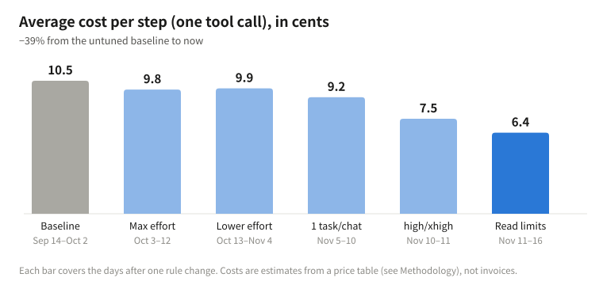
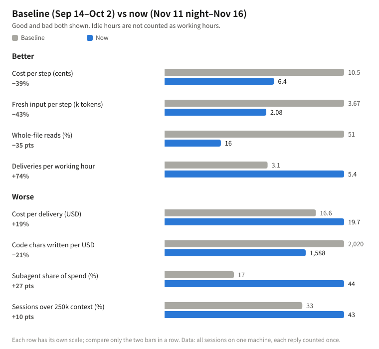
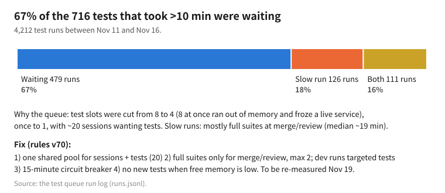
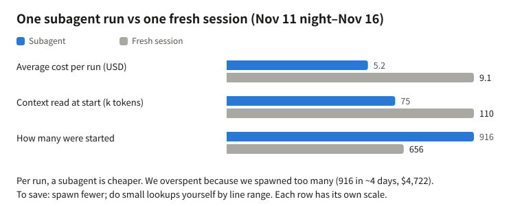
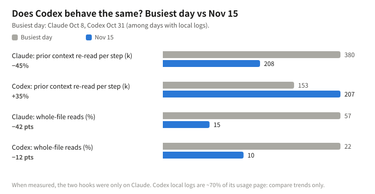

# Data report: how much did the token-saving changes actually save

[简体中文](data-report.md) | **English**

We measured every Claude Code session on one workstation, from the untuned baseline (Sep 14 – Oct 2) to now (Nov 11 night – Nov 16). Cost per step (one tool call) fell 39%, fresh input per step fell 43%, and whole-file reads fell from about half to about one sixth. But cost per delivery rose, code written per dollar fell, the subagent share of spend more than doubled, and total daily spend went up because many more sessions ran at once. All dollar figures are estimates from a price table, not invoices.

Data source: all Claude Code session logs on one workstation (main sessions + subagents), about 5,800 log files and 650,000 unique replies. The script that computes the numbers is this repo's [`tools/stages.cjs`](../tools/stages.cjs); you can use it to measure your own.

## 1. Conclusions in one line each

- **Got better**: each step is cheaper (−39%), fresh input per step is down 43%, whole-file reads dropped from half to one sixth, and deliveries per working hour are up 74%.
- **Got worse**: each delivery is actually more expensive (+19%), code characters written per dollar are down 21%, the subagent share of spend rose from 17% to 44%, and sessions whose context passed 250k rose from 33% to 43%.
- **Also note**: total spend per day went from about $390 to about $2,230 — not because unit cost went up, but because concurrent sessions went from a few to about twenty. Saving on unit cost is not the same as saving on the total bill.

## 2. All numbers for the six stages

Each stage covers the days after one rules change. "Untuned baseline" is the starting point, and every before/after comparison is computed from it; we don't pick a starting point that flatters us.

| Stage | Dates | Days | Cost per step (¢) | Fresh input per step (k tokens) | Whole-file reads | Subagent share of spend | Sessions with context > 250k | Code chars written per $ | Cost per delivery ($) | Deliveries per working hour |
|---|---|---|---|---|---|---|---|---|---|---|
| Untuned baseline | Sep 14 – Oct 2 | 18.5 | 10.5 | 3.67 | 51% | 17% | 33% | 2,020 | 16.6 | 3.1 |
| Max effort everywhere | Oct 3 – Oct 12 | 10 | 9.8 | 4.24 | 51% | 40% | 75% | 3,126 | 23.3 | 5.9 |
| Lower effort + scripts check first | Oct 13 – Nov 4 | 22.7 | 9.9 | 3.86 | 56% | 36% | 83% | 2,761 | 17.7 | 6.3 |
| One task, one conversation | Nov 5 – Nov 10 | 5.9 | 9.2 | 3.15 | 59% | 36% | 72% | 2,147 | 26.4 | 2.5 |
| Top two effort levels only | Nov 10 – Nov 11 | 1 | 7.5 | 2.65 | 55% | 38% | 45% | 2,970 | 10.1 | 14.4 |
| Read limits at the source | Nov 11 – Nov 16 | 4.8 | 6.4 | 2.08 | 16% | 44% | 43% | 1,588 | 19.7 | 5.4 |

Caveats when reading this table:

- "Top two effort levels only" covers just 1 day. The sample is too small, so that day's 14.4 deliveries per hour can't be taken as normal.
- Whole-file reads only really came down once we added the read line-limit hook ("Read limits at the source"); before that we relied on reminders written in the rules, which didn't work. **Words in the rules don't stop things the way a hook does.**
- Deliveries dropped noticeably during "One task, one conversation": that period was spent starting a new system, and a lot of the work hadn't reached a deliverable point yet.

## 3. Why tests got stuck

From Nov 11 to Nov 16 the test queue ran 4,212 tests; 716 of them took more than 10 minutes from entering the queue to finishing:

| Cause | Count | Share |
|---|---|---|
| Mostly waiting in the queue | 479 | 67% |
| Actually slow to run (mostly full test suites run at merge or verification review; median about 19 minutes, longest 74 minutes) | 126 | 18% |
| Both | 111 | 16% |

Why the queue: we once let 8 test runs go at the same time, ran out of memory, and the services in use on this machine stopped responding. So test slots were cut to 4, and one night temporarily to 1. With about twenty sessions all wanting to run tests, a long queue formed.

Fix (rules v70, live Nov 16; it is this repo's [`tools/test-queue.cjs`](../tools/test-queue.cjs)):

1. **Shared pool**: active sessions and running tests share one pool of 20 slots, with at least 2 reserved for tests. When fewer sessions are active, more tests are let through automatically.
2. **Tiers**: full test suite / whole-directory runs are allowed only at merge and verification review, at most 2 at a time; during development, only tests targeting specific files or cases run, and small tests queued behind a full suite go first.
3. **Circuit breaker**: any single run that reaches 15 minutes has its whole process tree killed.
4. **Memory guard**: no new tests start when free memory is below 8 GB (running ones are not stopped).

> **We will re-measure the effect of this version on Nov 19** (runs over 10 minutes, share that is mostly queue wait, circuit-breaker trips) and add the results to this section.

One more note: the before/after table above doesn't include "share of tests over 10 minutes", because that methodology only counted tests the AI waited on in the foreground and left out tests run in the background, so it reads low (baseline 0.1%, now 1.0%). This section uses the queue's own run log, which is more accurate.

## 4. Subagent vs. fresh session: which costs more

| | Runs | Total ($) | Average per run ($) | Read in at start (k tokens) | Average steps |
|---|---|---|---|---|---|
| Subagent | 916 | 4,722 | 5.2 | 75 | 88 |
| Fresh session | 656 | 5,979 | 9.1 | 110 | 115 |
| of which: small sessions under $5 | 213 | 690 | 3.2 | 112 | 53 |

Per run, subagents are cheaper. They cost a lot because **we spawned too many**: 916 in a little over 4 days. Replacing subagents with fresh sessions would make the same work cost more per run; the real saving comes from **spawning fewer**: do small lookups yourself by reading line ranges, and spawn only when you have to.

**What they were spawned for** (927 subagents since the night of Nov 11, classified by the first sentence of the task): reviews / acceptance checks 505, 3,286 USD, **68%** of subagent spend; searching and reading code 382, 29%; writing code only 1%. Grouping reviews by the branch they checked, the same branch was often reviewed again by several sessions (one line was reviewed 72 times by 10 sessions); counting from the second review on, the repeats cost about 2,100 USD. That is an upper bound: new commits on the same branch are counted too.

**So why did each delivery get more expensive**: of 16.6 → 19.7 USD per delivery, the main-session part went 13.8 → 11.0 (−20%) and the subagent part 2.8 → 8.7 (×3). The whole increase is subagents, mostly duplicate reviews. Our fix is a hook: a review subagent must name the commit it checks, and the same commit reviewed within 24 hours is blocked. We will add the result after re-measuring.

## 5. Is Codex the same?

On the same machine we also use OpenAI Codex (desktop app) to write the same system. For each tool we compare its heaviest day with Nov 15 (Codex kept no local logs for Nov 2 – Nov 10, so we use its heaviest local day, Oct 31). The numbers are computed with the same reader, this repo's `tools/token-usage.cjs --agent codex`. Methodology: one step = one model reply, and each reply is counted once.

| | Claude Oct 8 (peak) | Claude Nov 15 | Codex Oct 31 (peak) | Codex Nov 15 |
|---|---|---|---|---|
| Total for the day (billion tokens) | 9.86 | 2.84 | 10.15 | 4.44 |
| Steps that day | 25,889 | 13,610 | 65,873 | 21,302 |
| Prior context re-read per step (k tokens) | 380 | 208 (−45%) | 153 | **207 (+35%)** |
| Fresh input per step (k tokens) | 6.4 | 2.2 | 2.9 | 2.2 |
| Share of whole-file reads | 57% | 15% | 22% | 10% |
| Share spent re-reading prior context | 98% | 99% | 98% | 99% |

Honestly:

- **Same**: on both sides 98–99% of tokens go to re-reading prior context (cache reads); fresh input per step is now around 2.2k on both.
- **Different**: Claude's prior context per step was cut from 380k to 210k (handing off to a fresh conversation at about 250k worked); Codex's went up from 150k to 210k, as conversations got longer.
- **Whole-file reads**: Claude got from 57% down to 15% because of the blocking hook; Codex already tends to read only a range, so even without a hook it is only 10–20%.
- **At the time, the hooks only covered Claude**: when we took these measurements, the read line-limit and test-queue hooks were installed only in Claude Code; Codex had only the written rules in AGENTS.md, and Codex's default thinking effort level was also set to the highest. On Nov 16 we connected the same two hooks to our local Codex (tested: they block), and we'll add the effect after re-measuring.
- **Methodology gap**: Codex's local logs come to about 70% of what its official usage page reports, so this compares trends, not absolute amounts.

## 6. Methodology

- **Each reply counted once**: Claude Code writes one reply as several lines in the session log; we deduplicate globally by reply ID (`message.id`), and tool calls by call ID.
- **Spend is an estimate**: "equivalent dollars" converted from a price table, not an invoice. Subscription users are counted the same way, so the numbers are comparable. Formula (per million tokens):
  `input × input price + cache write (5 min) × input price × 1.25 + cache write (1 h) × input price × 2 + cache read × 0.2 (a flat $0.20 per million, regardless of model) + output × output price`.
  Input / output prices depend on the model and are set in `prices` in [`config/stages.example.json`](../config/stages.example.json); change them to match your own plan.
- **Step** = one tool call (read a file, run a command, edit a file…). **Fresh input** = input + cache writes, excluding cache reads, i.e. what actually enters the context for the first time.
- **Working hours** = hours with ≥ $1 spend. Idle hours and nights with nobody working don't count, so "deliveries per working hour" isn't diluted by downtime.
- **Deliveries**: one delivery note is written per finished task, and we count the note files. This is a rough methodology: big and small tasks each count as one, and note-writing habits also changed across rules changes. So "cost per delivery" shows only a trend, not a precise unit price.
- **Context over 250k**: main sessions only, using the largest context each session ever reached (input + cache writes + cache reads).
- **Code characters written per dollar**: only new characters written into code files (.js, .py, etc.) via Edit / Write; docs not counted.

## 7. Limitations

- Data from only one machine, one team and two months, tied to our business, codebase and working habits; numbers will differ on another project.
- Many things changed at once between stages (number of concurrent sessions, kinds of tasks, models), so a stage's change can't all be credited to that one rule.
- We have corrected our own conclusion: an earlier version said "59% saved per step", computed with Nov 10 as the starting point; measured from the untuned baseline it is 39%, and this has been corrected.
