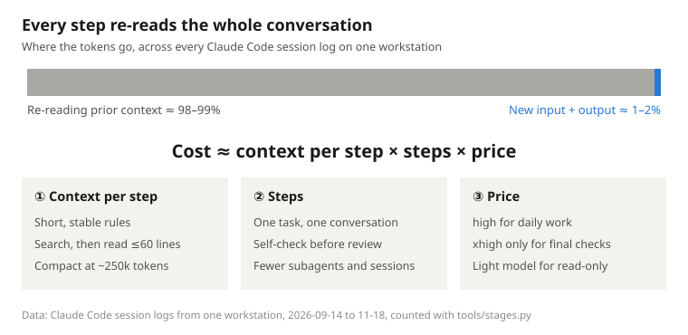

# Data report: where the money goes, how to cut it, what we measured

[简体中文](data-report.md) | **English**

Source: every Claude Code session log on one workstation (main sessions + subagents). The counting script is this repo's [`tools/stages.py`](../tools/stages.py); you can run it on your own logs.

## 1. First principles: you pay for re-reading

Every step an AI coding agent takes (read a file, run a command, edit a file) sends the whole conversation, rules included, back to the model. In our logs, **98–99% of tokens are this re-reading**. New input and output are only 1–2%.

So:

**Cost ≈ context per step × steps × price**

Each factor has one lever, and every part of this repo maps to one of them:

| Factor | How to cut it | In this repo |
|---|---|---|
| Context per step | Keep rules short and stable so the fixed prefix stays cached; search first, then read at most 60 lines at a time, with a hook that blocks whole-file reads of large files; compact at about 250k tokens (in Claude Code, set `CLAUDE_AUTOCOMPACT_PCT_OVERRIDE` for your window size) | [Rule templates](../rules/), [`hooks/read-limit-hook.py`](../hooks/read-limit-hook.py), [Read on demand](read-on-demand.en.md) |
| Steps | One task per conversation; run the local self-check before review to avoid rework; every new subagent or session starts by reading 75k–110k tokens, so open one only when needed; queue tests so they don't fight for memory or re-run for nothing | [`tools/self-check.py`](../tools/self-check.py), [task template](../templates/dispatch/task.md), [`tools/test-queue.py`](../tools/test-queue.py) |
| Price | Fix model and effort per role: high for daily work, xhigh only for final checks on money, big refactors and releases; a light model for read-only work | [Role table](../README.en.md#four-platforms--four-roles), [Effort guide](effort.en.md) |

Test queue rules ([`tools/test-queue.py`](../tools/test-queue.py)): active sessions and running tests share a pool of 20 slots, with at least 2 kept for tests; at most 2 full-suite runs at once, and during development only the touched files or cases run; any run that hits 15 minutes has its whole process tree stopped; no new test starts while free memory is under 8 GB.

## 2. Results

| Metric | Untuned (Sep 14–Oct 2) | Now (Nov 17–18) | Change |
|---|---|---|---|
| Cost per step (cents) | 10.5 | 5.8 | −45% |
| Fresh input per step (k tokens) | 3.67 | 2.14 | −42% |
| Whole-file reads | 51% | 23% | −55% |
| Sessions over 250k context | 33% | 6% | −82% |

Per finished feature: each feature that passed review cost $26.8 on average from Nov 10–16 and $17.2 from Nov 17–18 (−36%). This metric starts on Nov 10, so its starting point differs. Some of those features were written by a cloud coding agent whose spend is not in the local logs, so this number is optimistic; we will update it once that spend is included.

## 3. Method

- **Each reply counted once**: Claude Code writes one reply as several log lines, so replies are de-duplicated globally by `message.id`; tool calls are de-duplicated by call ID.
- **Cost is an estimate**: “equivalent dollars” from a price table, not a bill. Subscription users are counted the same way so periods can be compared. Formula (per million tokens):
  `input × input price + cache write (5 min) × input price × 1.25 + cache write (1 h) × input price × 2 + cache read × 0.2 + output × output price`.
  Prices per model are in `prices` in [`gate.config.example.json`](../gate.config.example.json); change them to match your plan.
- **One step** = one tool call (read a file, run a command, edit a file…). **Fresh input** = input + cache writes, excluding cache reads: what actually enters the context.
- **Re-read share** = cache reads ÷ all tokens (the “cached” figure printed by [`tools/token-usage.py`](../tools/token-usage.py)).
- **Context over 250k**: main sessions only, using the largest context each session reached (input + cache writes + cache reads).
- **Cost per finished feature** = all local session spend in the period ÷ features that passed review in the period.

## 4. Limits

- One machine, one team, two months of data, tied to our business, codebase and habits. Numbers will differ on another project.
- “Now” is only about 1.5 days (Nov 17 00:00 to the morning of Nov 18); it will be updated after 7 days.
- Several practices were adopted together, so the table does not split the change by practice.
