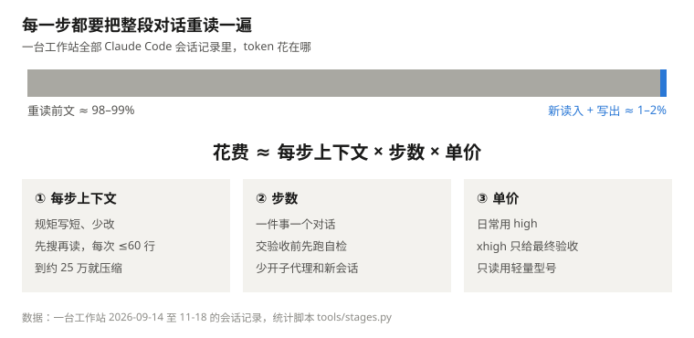

# 数据报告：钱花在哪、怎么省、省了多少

**简体中文** | [English](data-report.en.md)

数据来源：一台工作站上全部 Claude Code 会话记录（主会话 + 子代理）。统计脚本就是本仓库的 [`tools/stages.py`](../tools/stages.py)，你可以拿它量自己的。

## 一、第一性原理：钱花在重读上

AI 编程助手每走一步（读文件、跑命令、改文件），都要把整段对话连同规矩重新发给模型一遍。我们的记录里，**98–99% 的 token 花在这种重读上**，真正新读进来的和写出来的只占 1–2%。

所以：

**花费 ≈ 每步上下文 × 步数 × 单价**

三个乘数各有一个杠杆，本仓库的每个组件都对着其中一个：

| 乘数 | 怎么压 | 本仓库对应 |
|---|---|---|
| 每步上下文 | 规矩写短、少改，固定的开头能走缓存；先搜索再按行读，每次 ≤60 行，整份读大文件由钩子拦下；上下文到约 25 万 token 就压缩（Claude Code 可用环境变量 `CLAUDE_AUTOCOMPACT_PCT_OVERRIDE` 按窗口换算） | [规矩模板](../rules/)、[`hooks/read-limit-hook.py`](../hooks/read-limit-hook.py)、[按需读取](read-on-demand.md) |
| 步数 | 一件事一个对话；写完先跑本地自检再交验收，少返工；每开一个子代理或新会话，开张要先读进 7.5 万–11 万 token，非开不可才开；测试排队，不抢内存、不白跑 | [`tools/self-check.py`](../tools/self-check.py)、[写审模板](../templates/dispatch/task.md)、[`tools/test-queue.py`](../tools/test-queue.py) |
| 单价 | 按角色定型号和档位：日常用 high，xhigh 只给算钱、大重构、发布的最终验收；只读用轻量型号 | [角色表](../README.md#四个平台--四个角色)、[档位说明](effort.md) |

测试排队的规则（[`tools/test-queue.py`](../tools/test-queue.py)）：正在干活的会话和在跑的测试共用一个 20 位的池子，测试至少留 2 位；整套测试最多 2 份同时，开发期只跑改到的文件或用例；单次跑满 15 分钟强制结束整棵进程树；空闲内存低于 8 GB 不放新测试。

## 二、结果

| 指标 | 未调整（9/14–10/2） | 现在（11/17–11/18） | 变化 |
|---|---|---|---|
| 每一步花费（美分） | 10.5 | 5.8 | −45% |
| 每一步新读入（千 token） | 3.67 | 2.14 | −42% |
| 整份读文件的占比 | 51% | 23% | −55% |
| 上下文超 25 万的会话 | 33% | 6% | −82% |

按整项功能算：每项通过验收的功能，11/10–11/16 平均 26.8 美元，11/17–11/18 平均 17.2 美元（−36%）。这一项从 11/10 开始记，所以起点不同；分母里有一部分是云端编码代理写的功能，它的花费不在本机记录里，所以这个数偏乐观，补齐后更新。

## 三、口径

- **同一条回复只算一次**：Claude Code 会把一条回复拆成几行写进会话记录，统计时按回复编号（`message.id`）全局去重；工具调用按调用编号去重。
- **花费是估算**：按价目表折算的“等价美元”，不是账单，订阅用户也照这个算，方便横向比。公式（每百万 token）：
  `输入 × 入价 + 缓存写(5 分钟) × 入价 × 1.25 + 缓存写(1 小时) × 入价 × 2 + 缓存读 × 0.2 + 输出 × 出价`。
  入价 / 出价按型号取，写在 [`gate.config.example.json`](../gate.config.example.json) 的 `prices`，按你自己的套餐改。
- **一步** = 一次工具调用（读文件、跑命令、改文件……）。**新读入** = 输入 + 缓存写，不含缓存读，即真正新进上下文的量。
- **重读占比** = 缓存读 ÷ 全部 token（[`tools/token-usage.py`](../tools/token-usage.py) 输出的 cached）。
- **上下文超 25 万**：只看主会话，取每个会话出现过的最大上下文（输入 + 缓存写 + 缓存读）。
- **每项通过验收的功能** = 同期本机全部会话花费 ÷ 同期验收通过的功能项数。

## 四、局限

- 只有一台机器、一个团队、两个月的数据，和我们的业务、代码库、做事习惯绑在一起，换个项目数字会不一样。
- “现在”只有约一天半（11/17 00:00 到 11/18 上午），满 7 天后更新。
- 几样做法是一起上的，表里的变化不拆到单条做法头上。
