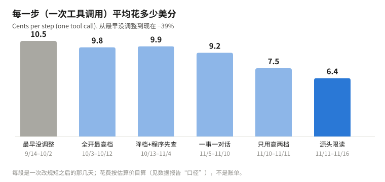
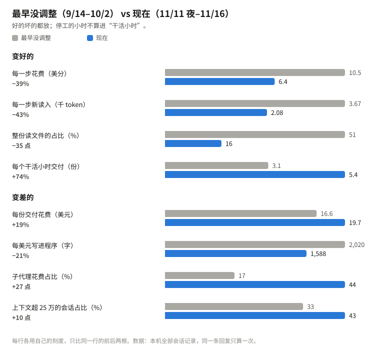
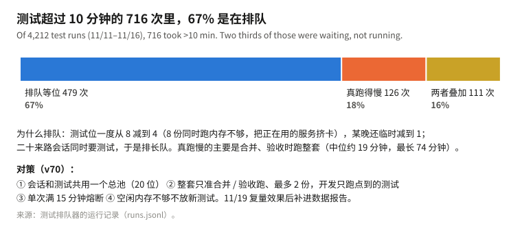
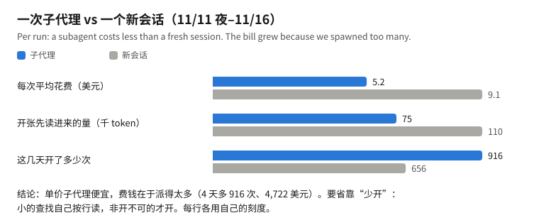
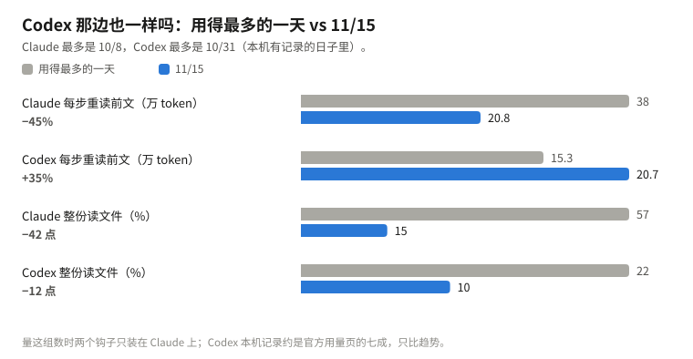

# 数据报告：省 TOKEN 的改动到底省了多少

**简体中文** | [English](data-report.en.md)

数据来源：一台工作站上全部 Claude Code 会话记录（主会话 + 子代理），共约 5,800 个记录文件、65 万条不重复的回复。统计脚本就是本仓库的 [`tools/stages.cjs`](../tools/stages.cjs)，你可以拿它量自己的。

## 一、一句话结论

- **变好的**：每一步更便宜（−39%），每一步新读进来的东西少了 43%，整份读文件从一半降到六分之一，每个干活小时交付的份数多了 74%。
- **变差的**：每份交付反而更贵（+19%），每美元写进程序的字数少了 21%，子代理花的钱占比从 17% 涨到 44%，上下文超过 25 万的会话从 33% 涨到 43%。
- **还要注意**：每天总花费从约 390 美元涨到约 2,230 美元——不是因为单价涨了，是因为同时开的会话从几路变成了二十来路。省单价不等于省总账。

## 二、六个阶段的全部数字

每段是一次改规矩之后的那几天。“最早没调整”是起点，所有“前后对比”都从它算，不挑对自己有利的起点。

| 阶段 | 日期 | 天数 | 每步花费（美分） | 每步新读入（千） | 整份读文件 | 子代理花费占比 | 上下文超 25 万的会话 | 每美元写进程序（字） | 每份交付（美元） | 每干活小时交付（份） |
|---|---|---|---|---|---|---|---|---|---|---|
| 最早没调整 | 9/14–10/2 | 18.5 | 10.5 | 3.67 | 51% | 17% | 33% | 2,020 | 16.6 | 3.1 |
| 全开最高档 | 10/3–10/12 | 10 | 9.8 | 4.24 | 51% | 40% | 75% | 3,126 | 23.3 | 5.9 |
| 降档 + 程序先查 | 10/13–11/4 | 22.7 | 9.9 | 3.86 | 56% | 36% | 83% | 2,761 | 17.7 | 6.3 |
| 一事一对话 | 11/5–11/10 | 5.9 | 9.2 | 3.15 | 59% | 36% | 72% | 2,147 | 26.4 | 2.5 |
| 只用高两档 | 11/10–11/11 | 1 | 7.5 | 2.65 | 55% | 38% | 45% | 2,970 | 10.1 | 14.4 |
| 源头限读 | 11/11–11/16 | 4.8 | 6.4 | 2.08 | 16% | 44% | 43% | 1,588 | 19.7 | 5.4 |

读这张表要注意：

- “只用高两档”只有 1 天，样本太小，那天的 14.4 份/小时不能当常态。
- “整份读文件”直到加了读文件限行钩子（源头限读）才真正降下来；之前只靠写在规矩里提醒，没用。**写在规矩里的话不如钩子拦得住。**
- 交付份数在“一事一对话”那段明显掉了：那段在开新系统，很多活还没到能交付的时候。

## 三、测试为什么卡

11/11–11/16 测试排队器一共跑了 4,212 次测试，716 次从排队到跑完超过 10 分钟：

| 原因 | 次数 | 占比 |
|---|---|---|
| 排队等位为主 | 479 | 67% |
| 真跑得慢（多是合并、验收时跑整套，中位约 19 分钟，最长 74 分钟） | 126 | 18% |
| 两者叠加 | 111 | 16% |

为什么排队：曾经让 8 份测试同时跑，内存不够，把这台机器上正在用的服务挤得不回话；于是测试位减到 4 个，某晚还临时减到 1 个。二十来路会话同时要跑测试，就排成长队。

对策（第 70 版规矩，11/16 上线，就是本仓库的 [`tools/test-queue.cjs`](../tools/test-queue.cjs)）：

1. **总池**：正在干活的会话和在跑的测试共用一个 20 位的池子，测试至少留 2 位。会话少的时候测试自动多放。
2. **分级**：整套 / 整目录测试只准合并、验收跑，最多 2 份同时；开发期只跑点到具体文件或用例的测试，排在整套后面的小测试先走。
3. **熔断**：单次跑满 15 分钟强制结束整棵进程树。
4. **内存保护**：空闲内存低于 8 GB 不放新测试（在跑的不停）。

> **11/19 会复量这一版的效果**（超 10 分钟的次数、排队为主的占比、熔断次数），量完补进这一节。

另外要说明：上一张前后对比表里没有放“测试超 10 分钟占比”，因为那个口径只算了 AI 在前台干等的测试，放到后台跑的没算进去，会偏低（起点 0.1%，现在 1.0%）。这一节用的是排队器自己的运行记录，更准。

## 四、子代理和新会话，哪个费钱

| | 次数 | 合计（美元） | 每次平均（美元） | 开张先读进来的量（千 token） | 平均步数 |
|---|---|---|---|---|---|
| 子代理 | 916 | 4,722 | 5.2 | 75 | 88 |
| 新会话 | 656 | 5,979 | 9.1 | 110 | 115 |
| 其中花不到 5 美元的小会话 | 213 | 690 | 3.2 | 112 | 53 |

单价上子代理便宜。费钱是因为**派得太多**：4 天多派了 916 次。把子代理换成新会话，同样的活单价会更高；真正要省得靠**少开**：小的查找自己按行号读，非开不可的才开。

**派去干什么**（11/11 晚起 927 个子代理，按派它时第一句话分类）：复验 / 验收 / 审查 505 个、3,286 美元，占子代理花费 **68%**；查找、读代码 382 个、29%；写代码只占 1%。验收类按“验的是哪个分支”归组，同一个分支常被好几个会话各验一遍（最多的一条线被 10 个会话验了 72 次）；从第二次起算，重复部分约 2,100 美元。这是上限：同一分支上的新提交也算进去了。

**所以每份活为什么变贵**：每份交付 16.6 → 19.7 美元里，主会话那部分 13.8 → 11.0（−20%），子代理那部分 2.8 → 8.7（×3）。涨的全在子代理，主要是重复验收。我们的对策是加一个钩子：派验收子代理必须写明验哪个提交，同一提交 24 小时内验过就拦下；复量后补进来。

## 五、Codex 那边也一样吗

同一台机器上我们也用 OpenAI Codex（桌面应用）写同一套系统。各拿用得最多的一天和 11/15 比（Codex 本机 11/2–11/10 没留记录，所以用本机最多的 10/31）。数据由本仓库 `tools/token-usage.cjs --agent codex` 同一套读法算，口径：一步 = 一次模型回复，同一条回复只算一次。

| | Claude 10/8（最多） | Claude 11/15 | Codex 10/31（最多） | Codex 11/15 |
|---|---|---|---|---|
| 当天总量（亿 token） | 98.6 | 28.4 | 101.5 | 44.4 |
| 当天步数 | 25,889 | 13,610 | 65,873 | 21,302 |
| 每步要重读的前文（万 token） | 38.0 | 20.8（−45%） | 15.3 | **20.7（+35%）** |
| 每步新读进来的（千 token） | 6.4 | 2.2 | 2.9 | 2.2 |
| 整份读文件的占比 | 57% | 15% | 22% | 10% |
| 花在重读前文上的比例 | 98% | 99% | 98% | 99% |

照实说：

- **一样的**：两边 98–99% 的 token 都花在重读前文上；现在每一步新读进来的都在 2.2 千左右。
- **不一样的**：Claude 每步前文从 38 万砍到 21 万（到约 25 万就交接换新对话，起了作用）；Codex 反而从 15 万涨到 21 万，对话拖长了。
- **整份读文件**：Claude 是靠拦截钩子从 57% 压到 15% 的；Codex 本来就习惯只读一段，没有钩子也只有 1–2 成。
- **钩子当时只管得到 Claude**：量这组数的时候，读文件限行、测试排队这两个钩子只装在 Claude Code 上，Codex 只看 AGENTS.md 里的文字规矩；Codex 默认思考档也开在最高档。11/16 我们把同样两个钩子接进了本机 Codex（实测能拦），效果等复量后再补进来。
- **口径差**：Codex 本机记录约是它官方用量页统计的七成，比的是趋势，不是绝对量。

## 六、口径说明

- **同一条回复只算一次**：Claude Code 会把一条回复拆成几行写进会话记录，统计时按回复编号（`message.id`）全局去重；工具调用按调用编号去重。
- **花费是估算**：按价目表折算的“等价美元”，不是账单，订阅用户也照这个算，方便横向比。公式（每百万 token）：
  `输入 × 入价 + 缓存写(5 分钟) × 入价 × 1.25 + 缓存写(1 小时) × 入价 × 2 + 缓存读 × 0.2 + 输出 × 出价`。
  入价 / 出价按型号取，写在 [`config/stages.example.json`](../config/stages.example.json) 的 `prices`，按你自己的套餐改。
- **一步** = 一次工具调用（读文件、跑命令、改文件……）。**新读入** = 输入 + 缓存写，不含缓存读，即真正新进上下文的量。
- **干活的小时** = 当小时花费 ≥ 1 美元的小时。停工、夜里没人用的小时不算，所以“每干活小时交付”不会因为停工被稀释。
- **交付份数**：每办完一件事写一份交付记录，按记录文件数算。它是粗口径：大活小活都算一份，改规矩前后写记录的习惯也有变化。所以“每份交付花费”只能看趋势，不能当精确单价。
- **上下文超 25 万**：只看主会话，取每个会话出现过的最大上下文（输入 + 缓存写 + 缓存读）。
- **每美元写进程序的字数**：只数 Edit / Write 写进代码文件（.js、.py 等）的新字符，不数文档。

## 七、局限

- 只有一台机器、一个团队、两个月的数据，和我们的业务、代码库、做事习惯绑在一起，换个项目数字会不一样。
- 阶段之间同时变了很多东西（会话路数、任务种类、型号），一个阶段的变化不能全算在那一条规矩头上。
- 我们修正过自己的结论：早先一版说“每步省 59%”，是拿 11/10 当起点算的；从最早没调整算起应是 39%，已经改正。
